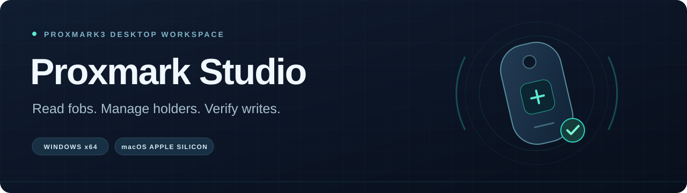
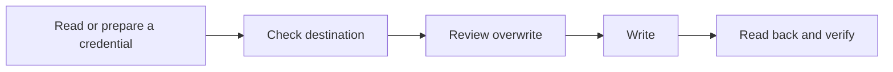

<p align="center">
  
</p>

<p align="center">
  <a href="https://github.com/TechKno/proxmark-studio/releases/latest"></a>
  <a href="https://github.com/TechKno/proxmark-studio/actions/workflows/build.yml"></a>
  <a href="LICENSE"></a>
</p>

<p align="center">
  <a href="#download">Download</a> ·
  <a href="#quick-start">Quick start</a> ·
  <a href="#organisation-mode">Organisations</a> ·
  <a href="#build-from-source">Build from source</a>
</p>

Proxmark Studio is a desktop app for **reading, cloning and programming fobs with a Proxmark3**, using the RRG/Iceman client. Guided workflows handle destination checks and independent read-back, while private organisation registers keep users, fob assignments and reserved numbers together.

Try it with the bundled demo, or connect your own reader. New installations start without company data.

## Download

| Platform | Download 0.9.0 | Open after extracting |
| --- | --- | --- |
| **Windows x64** | [Download Windows ZIP](https://github.com/TechKno/proxmark-studio/releases/download/v0.9.0/ProxmarkStudio-0.9.0-Windows-x64.zip) | `proxmark-studio.exe` — keep `mock-pm3.exe` beside it |
| **macOS · Apple Silicon** | [Download Mac ZIP](https://github.com/TechKno/proxmark-studio/releases/download/v0.9.0/ProxmarkStudio-0.9.0-macOS-arm64.zip) | `Proxmark Studio.app` inside the extracted folder |

[All releases](https://github.com/TechKno/proxmark-studio/releases) · [SHA-256 checksums](https://github.com/TechKno/proxmark-studio/releases/download/v0.9.0/SHA256SUMS.txt) · [Source ZIP](https://github.com/TechKno/proxmark-studio/releases/download/v0.9.0/ProxmarkStudio-0.9.0-GitHub-source.zip)

Windows builds are unsigned. The Mac app is ad-hoc signed, not notarised; an Intel Mac build is not provided. Physical hardware requires a separately installed compatible **RRG/Iceman client**.

## Three ways to work

| Mode | What you can do |
| --- | --- |
| **Basic** | Read a fob, clone an original, or prepare a new credential. Check the destination, review the overwrite, then write and verify. |
| **Organisations** | Configure a site, import or add users, allocate unused numbers, find holders by scanning, and manage assignments, clones and card-number changes. |
| **Advanced** | Work with protocol tools, card memory, credential formats, diagnostics and an interactive client console. |

Programming success requires an independent read-back. A completed write command alone is not enough.



## Quick start

### Try the demo — no reader needed

1. Download and extract the app for your platform.
2. Open **Basic → Device setup → Try demo with mock client**.
3. Use the demo controls to place a simulated fob, then try reading or cloning it.

Demo results are marked **SIMULATED** and use a separate temporary register. Choose **End demo** to return to your physical connection settings.

### Connect a physical reader

1. Install a native [RRG/Iceman Proxmark3 client](https://github.com/RfidResearchGroup/proxmark3) compatible with your reader's firmware. Keep its runtime files and resources together.
2. Connect the reader and open **Basic → Device setup**.
3. Select the client executable, its working folder and the reader's serial port.
4. Choose **Check connection**, review the client/firmware result, then **Save connection**.

> **“Cannot start configured CLI: program not found”?** Select the full path to the installed `proxmark3.exe` or `proxmark3` executable. The default command name works only when the client is available on your system's `PATH`.

## Organisation mode

Keep a separate private register for each organisation or site. Configure your own names, facility code and number range; no organisation-specific setup is built into new installations.

1. Open **Organisations → New organisation**.
2. Set the organisation/site names, reader format, facility code and allocation range.
3. Confirm the format against the site's reader configuration, then save the register outside the source repository.
4. Add users or import the [synthetic CSV template](examples/synthetic-users.csv).

| Task | How it works |
| --- | --- |
| **Issue a new fob** | Select a user and reserve an unused number within your configured range. Cancelled or failed writes keep the number reserved. |
| **Find a holder** | Scan a known fob to select its assigned user. An unknown fob needs an explicit link. |
| **Reassign a fob** | Transfer it to another user while retaining the credential and assignment history. |
| **Clone an existing fob** | Read the original, check the blank, then write and verify the full ID. Both fobs share the same credential. |
| **Edit a fob** | Update its notes or prepare a new encoded card number. The old local record is retired only after the rewrite verifies. |
| **Delete a fob** | Remove it from the active local list while retaining its history and reserving its number. |

Organisation mode currently supports **EM410x fobs with Wiegand 26 or Wiegand 34 reader output**. Number allocation is unique within a register; it is not synchronised across independent copies or with a live controller.

Studio does not enrol credentials in an access controller or change door permissions. Apply enrolment, holder changes and revocation in your access system separately. Deleting a local record does not erase the physical fob or revoke access.

[Full organisation guide](ORGANISATIONS.md) · [Example profile](examples/synthetic-organisation-profile.json) · [CSV template](examples/synthetic-users.csv)

## Your data stays local

Organisation registers hold users, fobs, reservations and history in private local files. The public repository and downloads contain **synthetic examples only**.

- Keep registers, settings, exported profiles and backups outside the source repository.
- Git ignore rules exclude company records, exports, backups, logs and local configuration. Only named synthetic fixtures are exempt.
- Registers and exports are **plaintext**; optional Library encryption does not encrypt organisation files. Protect and back them up accordingly.
- Ignore rules do not remove files already committed to Git. Check tracked files and history before publishing an existing project.

See [security and private data](SECURITY.md) for storage and reporting guidance. Use Studio with readers, fobs and systems you are authorised to administer.

## Build from source

Use **Rust 1.99+** and the checked-in `Cargo.lock`. Windows needs the MSVC C++ build tools and Windows SDK; macOS needs Xcode command-line tools. Keep build caches outside synced folders.

```sh
git clone https://github.com/TechKno/proxmark-studio.git
cd proxmark-studio
cargo fmt --all -- --check
cargo clippy --locked --all-targets -- -D warnings
cargo test --locked
```

<details>
<summary><strong>Package for Windows x64</strong></summary>

Run in PowerShell from the project directory:

```powershell
$env:CARGO_TARGET_DIR = Join-Path $env:LOCALAPPDATA 'ProxmarkStudio\build-target'
rustup target add x86_64-pc-windows-msvc
.\scripts\package-windows.ps1
```

The script creates the versioned Windows ZIP in `dist/`, including both executables and synthetic examples.

</details>

<details>
<summary><strong>Package for macOS Apple Silicon</strong></summary>

Run on a Mac from the project directory:

```sh
export CARGO_TARGET_DIR="$HOME/Library/Caches/proxmark-studio/target"
rustup target add aarch64-apple-darwin
sh scripts/package-macos.sh
```

The script creates the app bundle and a versioned Mac ZIP in `dist/`. Signing is local ad-hoc signing; distribution signing and notarisation require your own Apple identity.

</details>

Preserve the [local eframe patch](vendor/eframe/STUDIO-PATCH.md). To check private-file exclusions or create a source ZIP, use Python and Git:

```sh
python scripts/package-source.py --check
python scripts/package-source.py
```

## Tested, with clear limits

The **0.9.0 release passed 250 automated tests on each platform**, with six opt-in tests excluded per platform. [The Windows and Mac build run](https://github.com/TechKno/proxmark-studio/actions/runs/41057149125) also passed formatting, Clippy and private-file ignore checks.

Automated checks cover allocation, organisation isolation, imports, migrations, mock programming and rejected writes. They do not establish physical reader or door-system acceptance. **EV2/LRP/EV3-specific operations remain unavailable.** See the [release notes](https://github.com/TechKno/proxmark-studio/releases/tag/v0.9.0) and [local validation record](VALIDATION.md) for the evidence and limits.

## Contribute

Bug reports, documentation improvements and contributions are welcome. Read the [contributing guide](CONTRIBUTING.md), then [open an issue](https://github.com/TechKno/proxmark-studio/issues) with your platform, app version and a synthetic reproducer. Keep real identities, access credentials, keys and card dumps out of public reports.

---

[MIT licence](LICENSE) · [Changelog](CHANGELOG.md) · [Organisation guide](ORGANISATIONS.md) · [Security](SECURITY.md)

Proxmark Studio is an independent project, not affiliated with RRG/Iceman or NXP.
